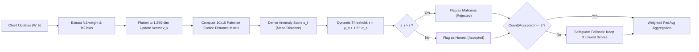
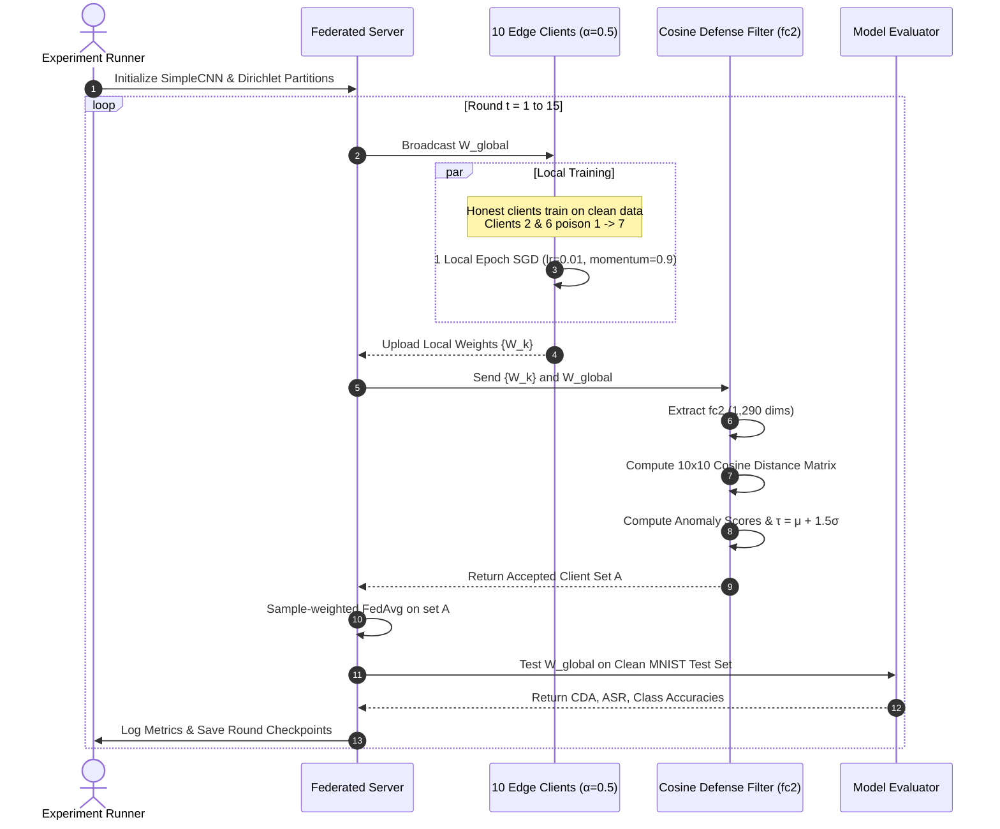
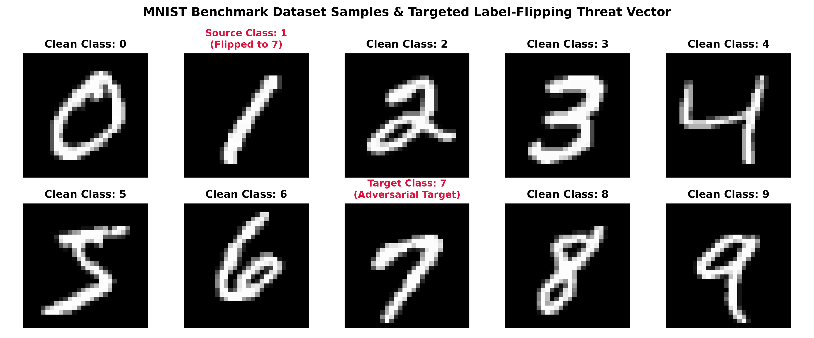
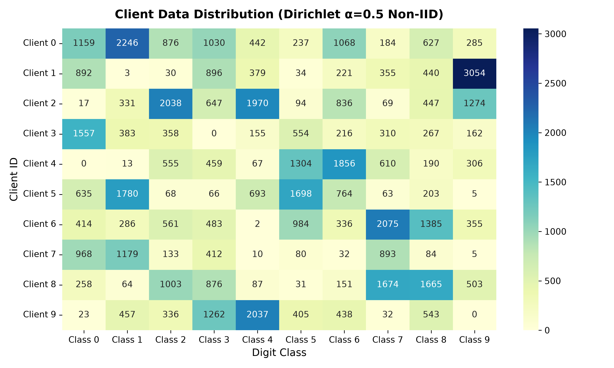
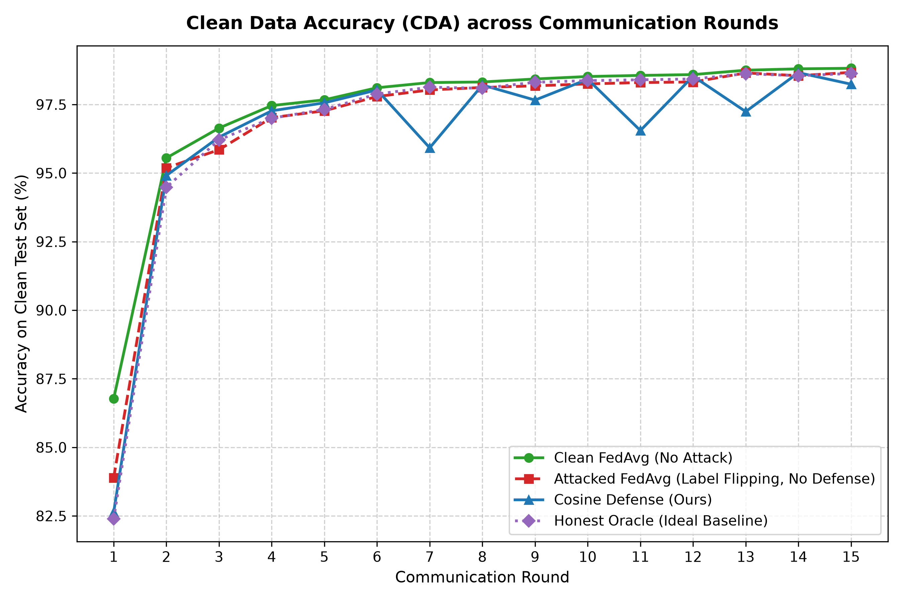
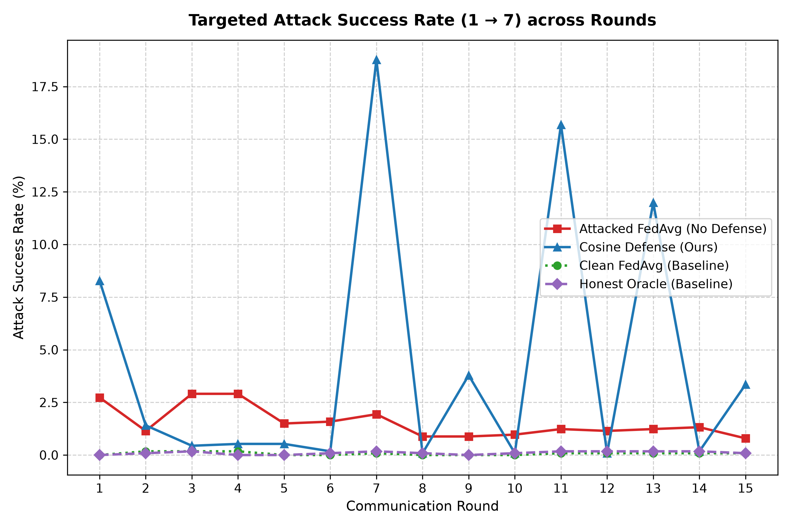
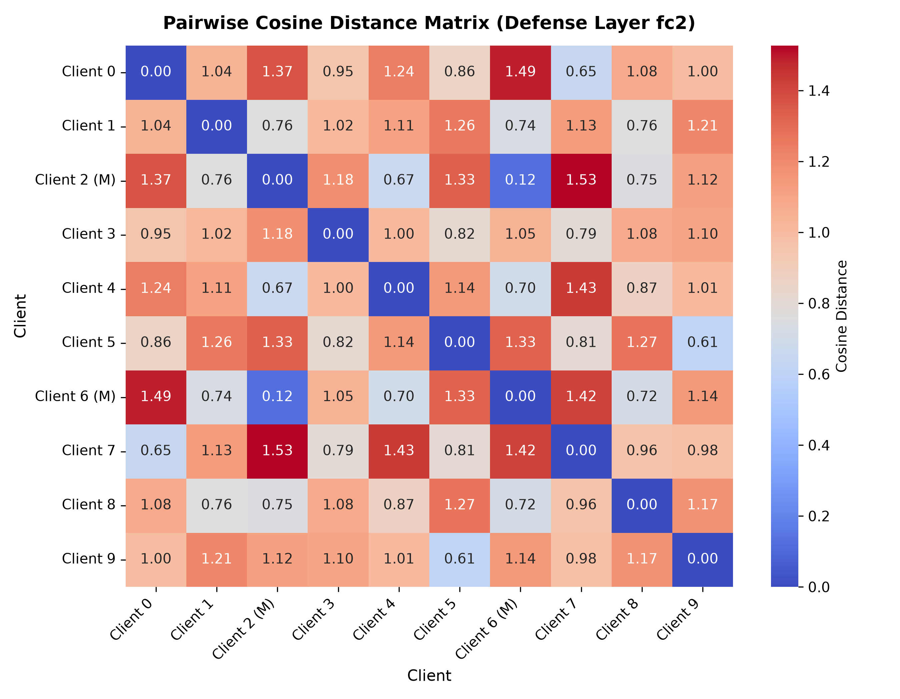
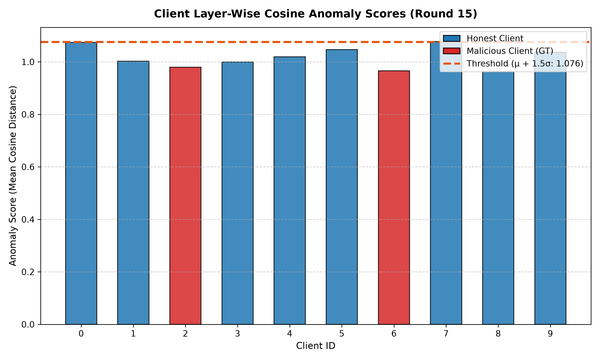
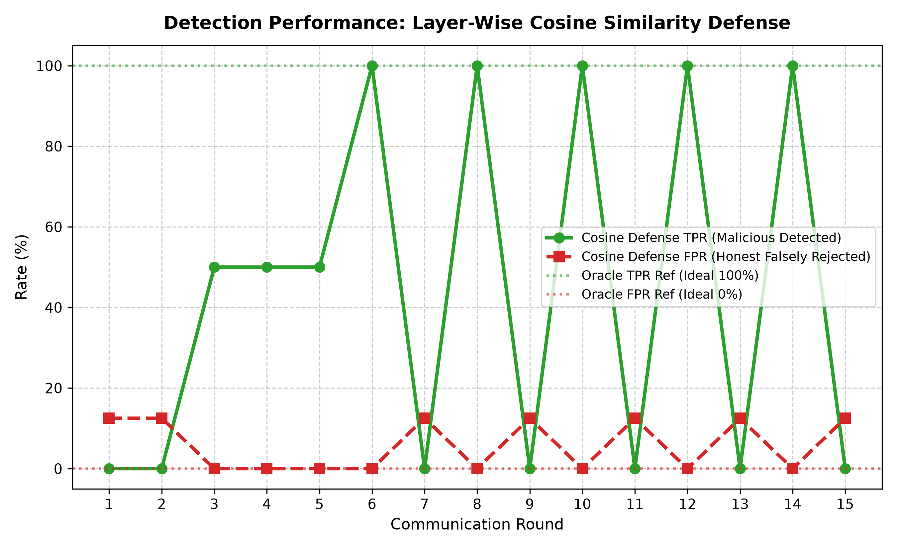

# FL-Poisoning-Detection: Detecting Targeted Label-Flipping Attacks in Non-IID Federated Learning Using Layer-Wise Cosine Similarity Filtering

[](https://www.python.org/)
[](https://pytorch.org/)
[](LICENSE)
[](tests/)
[](#1-overview--objective)

An end-to-end, framework-free PyTorch implementation of a 10-client Federated Learning simulation under class-wise Non-IID Dirichlet distribution ($\alpha=0.5$), targeted label-flipping poisoning attacks (digit $1 \to 7$), and a layer-wise cosine similarity filtering defense applied to the classification head (`fc2`, 1,290 parameters).

---

## Table of Contents
- [1. Overview & Objective](#1-overview--objective)
- [2. Model Architecture & Defense Layer Isolation](#2-model-architecture--defense-layer-isolation)
- [3. Threat Model & Targeted Label-Flipping Attack](#3-threat-model--targeted-label-flipping-attack)
- [4. Defense Methodology & Mathematical Formulation](#4-defense-methodology--mathematical-formulation)
- [5. System Architecture & Workflow](#5-system-architecture--workflow)
- [6. Project Structure](#6-project-structure)
- [7. Installation & Quickstart](#7-installation--quickstart)
- [8. Running Experiments & Tests](#8-running-experiments--tests)
- [9. Empirical Results & Image Diagnostics](#9-empirical-results--image-diagnostics)
  - [Figure 1: Benchmark Dataset & Targeted Poisoning Threat Vector](#figure-1-benchmark-dataset--targeted-poisoning-threat-vector)
  - [Figure 2: Non-IID Dirichlet Data Heterogeneity Heatmap](#figure-2-non-iid-dirichlet-data-heterogeneity-heatmap)
  - [Figure 3: Clean Data Accuracy (CDA) Progression](#figure-3-clean-data-accuracy-cda-progression)
  - [Figure 4: Targeted Attack Success Rate (ASR) Comparison](#figure-4-targeted-attack-success-rate-asr-comparison)
  - [Figure 5: Pairwise Cosine Distance Heatmap on Layer fc2](#figure-5-pairwise-cosine-distance-heatmap-on-layer-fc2)
  - [Figure 6: Client Anomaly Scores vs Adaptive Threshold](#figure-6-client-anomaly-scores-vs-adaptive-threshold)
  - [Figure 7: Defense Detection Performance (TPR & FPR)](#figure-7-defense-detection-performance-tpr--fpr)
  - [Quantitative Experimental Benchmark (Round 15)](#quantitative-experimental-benchmark-round-15)
- [10. In-Depth Scientific Analysis: Why Did the Defense Oscillate?](#10-in-depth-scientific-analysis-why-did-the-defense-oscillate)
  - [10.1 The Non-IID Confounding Effect](#101-the-non-iid-confounding-effect)
  - [10.2 The "Disarming the Honest Majority" Phenomenon](#102-the-disarming-the-honest-majority-phenomenon)
  - [10.3 Within-Client Poison Dilution](#103-within-client-poison-dilution)
- [11. Limitations & Future Directions](#11-limitations--future-directions)
- [12. Citation & License](#12-citation--license)

---

## 1. Overview & Objective

Federated Learning (FL) allows distributed edge clients to collaboratively train a centralized global neural network without sharing their raw private datasets. However, FL is fundamentally susceptible to poisoning attacks: malicious or Byzantine clients can manipulate local training data or gradient updates to sabotage model integrity.

In a **targeted label-flipping poisoning attack**, an adversary stealthily mislabels instances of a source class ($y_{src} = 1$) as a target class ($y_{tgt} = 7$) during local training. Because the global accuracy across all other classes remains high, standard utility-based anomaly detectors fail to detect the compromise.

This repository provides a self-contained, mathematically rigorous implementation in pure PyTorch:
1. **10-Client Decentralized Network:** Simulated across 15 communication rounds without heavy third-party FL frameworks (such as Flower or PySyft).
2. **Realistic Non-IID Statistical Skew:** Partitioned via class-wise Dirichlet distribution ($\alpha = 0.5$) with zero sample duplication across clients.
3. **Targeted Label-Flipping Attack:** 20% adversarial network fraction (Clients 2 and 6) intentionally flipping $100\%$ of digit $1$ training samples to label $7$.
4. **Layer-Wise Cosine Similarity Defense:** Isolates the final linear classification head (`fc2`, 1,290 parameters) to filter anomalous updates using an adaptive statistical threshold ($\tau = \mu + 1.5\sigma$) with fallback safeguards.
5. **Systematic 4-Mode Benchmark:** Direct empirical comparison across Clean FedAvg, Attacked FedAvg, Cosine Defense, and Honest-Only Oracle.

---

## 2. Model Architecture & Defense Layer Isolation

The neural network is a convolutional architecture (`SimpleCNN`) optimized for $28 \times 28$ grayscale images:

```
Input (1 × 28 × 28)
  │
  ├── Conv2d(in=1, out=32, kernel=3, padding=0) + ReLU
  ├── MaxPool2d(kernel=2, stride=2)   ──> Output: (32 × 13 × 13)
  │
  ├── Conv2d(in=32, out=64, kernel=3, padding=0) + ReLU
  ├── MaxPool2d(kernel=2, stride=2)   ──> Output: (64 × 5 × 5)
  │
  ├── Flatten()                       ──> Output: 1600
  ├── Linear(in=1600, out=128) [fc1] + ReLU
  └── Linear(in=128, out=10)   [fc2]  ──> Output: (batch_size × 10) [★ Target Layer ★]
```

### Parameter Breakdown

| Layer | Type | Input Dimension | Output Dimension | Trainable Parameters |
| :--- | :--- | :--- | :--- | :--- |
| `conv1` | Conv2d (3x3) | $(B, 1, 28, 28)$ | $(B, 32, 26, 26)$ | $32 \times (1 \times 3 \times 3) + 32 = 320$ |
| `pool1` | MaxPool2d (2x2) | $(B, 32, 26, 26)$ | $(B, 32, 13, 13)$ | $0$ |
| `conv2` | Conv2d (3x3) | $(B, 32, 13, 13)$ | $(B, 64, 11, 11)$ | $64 \times (32 \times 3 \times 3) + 64 = 18,496$ |
| `pool2` | MaxPool2d (2x2) | $(B, 64, 11, 11)$ | $(B, 64, 5, 5)$ | $0$ |
| `fc1` | Linear + ReLU | $(B, 1600)$ | $(B, 128)$ | $(1600 \times 128) + 128 = 204,928$ |
| **`fc2`** | **Linear (Head)** | **$(B, 128)$** | **$(B, 10)$** | **$(128 \times 10) + 10 = \mathbf{1,290}$** |
| **Total** | | | | **225,034 parameters** |

### Why Isolate `fc2` (1,290 Parameters)?
Targeted label-flipping specifically corrupts the mapping from high-level latent representations to the decision boundaries of classes $1$ and $7$. Computing distance metrics across the full 225,034 parameters introduces noise from lower convolutional feature extractors. Restricting anomaly detection to `fc2` concentrates the directional signal-to-noise ratio where the attack actually manifests.

---

## 3. Threat Model & Targeted Label-Flipping Attack

### Non-IID Dirichlet Partitioning ($\alpha = 0.5$)
- The 60,000 MNIST training samples are distributed among 10 clients via a symmetric Dirichlet distribution:
  $$\mathbf{p}_c = (p_{c, 0}, p_{c, 1}, \dots, p_{c, K-1}) \sim \text{Dirichlet}(\alpha, \dots, \alpha)$$
- $\alpha = 0.5$ creates high statistical heterogeneity: clients have dominant digit classes and near-zero representations of others.
- Strict constraints: zero duplicate indices, zero sample overlap, minimum 1,000 samples per client.

### Attack Vector
- **Adversarial Network Fraction:** 20% (Clients 2 and 6 are malicious).
- **Targeted Transformation:** Digit $1 \to$ Digit $7$.
- **Local Flipping Ratio:** 100% of local source-class training samples are converted to class 7.
- **Dataset Immutability:** Poisoning is executed on-the-fly during local client training. Global training datasets and the 10,000-sample test dataset remain strictly clean.

---

## 4. Defense Methodology & Mathematical Formulation

The server inspects client updates prior to aggregation without knowledge of client identities.



### Mathematical Steps

1. **Update Vector Extraction:**
   For each client $k$ and current global model $W_G$:
   $$\Delta W_k = W_k^{(t)} - W_G^{(t)}$$
   $$\mathbf{v}_k = \left[ \text{vec}(\Delta W_k^{(\text{fc2.weight})}) \,\|\, \Delta W_k^{(\text{fc2.bias})} \right] \in \mathbb{R}^{1290}$$

2. **Pairwise Cosine Distance Matrix:**
   For all client pairs $(i, j)$:
   $$D(i, j) = 1 - \frac{\mathbf{v}_i \cdot \mathbf{v}_j}{\|\mathbf{v}_i\|_2 \|\mathbf{v}_j\|_2 + \epsilon}$$
   where $\epsilon = 10^{-12}$ guarantees numerical stability. $D(i, j) \in [0, 2]$.

3. **Client Anomaly Score:**
   The anomaly score $s_i$ is the average cosine distance from client $i$ to all other clients:
   $$s_i = \frac{1}{K - 1} \sum_{j \neq i} D(i, j)$$

4. **Dynamic Statistical Thresholding:**
   $$\mu_s = \frac{1}{K} \sum_{i=0}^{K-1} s_i, \quad \sigma_s = \sqrt{\frac{1}{K} \sum_{i=0}^{K-1} (s_i - \mu_s)^2}$$
   $$\tau = \mu_s + m \cdot \sigma_s \quad (m = 1.5)$$
   Client $i$ is rejected if $s_i > \tau$; accepted otherwise.

5. **Safeguard Fallback:**
   If the set of accepted clients $|\mathcal{A}| < 3$, the system falls back to retaining the 3 clients with the smallest anomaly scores to prevent denial of service.

6. **Sample-Weighted FedAvg:**
   $$W_G^{(t+1)} = \sum_{k \in \mathcal{A}} \frac{n_k}{\sum_{j \in \mathcal{A}} n_j} W_k^{(t)}$$

---

## 5. System Architecture & Workflow



---

## 6. Project Structure

```
FL-Poisoning-Detection/
├── configs/
│   └── experiment.yaml          # Central experiment configuration (hyperparameters, paths)
├── data/                        # MNIST raw and processed binary datasets
├── experiments/
│   └── run_experiment.py        # CLI orchestration runner for all 4 simulation modes
├── notebooks/
│   └── analysis.ipynb           # Interactive analysis and diagnostics notebook
├── results/
│   ├── checkpoints/             # Saved PyTorch model checkpoints (.pt)
│   │   ├── initial_model.pt
│   │   ├── clean_fedavg_final.pt
│   │   ├── attacked_fedavg_final.pt
│   │   ├── cosine_defense_final.pt
│   │   └── honest_only_oracle_final.pt
│   ├── figures/                 # High-resolution (300 DPI) diagnostic plots
│   │   ├── mnist_samples.png
│   │   ├── client_class_distribution.png
│   │   ├── clean_accuracy_comparison.png
│   │   ├── attack_success_rate_comparison.png
│   │   ├── cosine_distance_heatmap.png
│   │   ├── client_anomaly_scores.png
│   │   └── detection_performance.png
│   ├── metrics/                 # Per-mode and combined CSV metric logs
│   │   ├── clean_fedavg_metrics.csv
│   │   ├── attacked_fedavg_metrics.csv
│   │   ├── cosine_defense_metrics.csv
│   │   ├── honest_only_oracle_metrics.csv
│   │   └── all_experiments_metrics.csv
│   └── partitions.json          # Dirichlet Non-IID client sample index assignments
├── src/
│   ├── __init__.py
│   ├── aggregation.py           # Mathematical sample-weighted FedAvg
│   ├── attacks.py               # Targeted label-flipping poisoning engine
│   ├── client.py                # Local SGD training loop and client abstraction
│   ├── dataset.py               # MNIST download, Dirichlet partitioner, ClientDataset
│   ├── defenses.py              # Layer-wise cosine distance calculation & adaptive filter
│   ├── evaluation.py            # Evaluation metrics (CDA, ASR, Class Accuracies, TPR, FPR)
│   ├── model.py                 # SimpleCNN architecture (225k params, 1,290 in fc2)
│   ├── server.py                # Server coordination, broadcasting, and aggregation
│   ├── utils.py                 # Seed management, I/O helpers, checkpoint management
│   └── visualization.py         # 300 DPI publication figure generators
├── tests/                       # Complete Pytest test suite (17 tests)
│   ├── __init__.py
│   ├── test_aggregation.py      # FedAvg mathematical correctness and edge cases
│   ├── test_attacks.py          # Label-flipping isolation and partition immutability
│   ├── test_client.py           # Client local optimization step
│   ├── test_dataset.py          # Dirichlet partition constraints and no data leakage
│   ├── test_defenses.py         # Cosine distance math, thresholding, and safeguards
│   ├── test_evaluation.py       # Metrics verification (CDA, ASR, TPR, FPR)
│   └── test_model.py            # CNN forward pass and fc2 parameter verification
├── .gitignore
├── LICENSE                      # MIT License
├── README.md                    # Project documentation
└── requirements.txt             # Frozen Python dependencies
```

---

## 7. Installation & Quickstart

### Prerequisites
- Linux / macOS / Windows WSL2
- Python `>= 3.10`
- CUDA-compatible GPU (optional; automatically falls back to CPU)

### Setup Instructions

```bash
# 1. Clone repository
git clone https://github.com/your-username/FL-Poisoning-Detection.git
cd FL-Poisoning-Detection

# 2. Create and activate a Python virtual environment
python3 -m venv .venv
source .venv/bin/activate

# 3. Install dependencies
pip install --upgrade pip
pip install -r requirements.txt
```

---

## 8. Running Experiments & Tests

### Run Unit Tests
Verify all 17 unit tests across data partitioning, local optimization, cosine distance computation, and aggregation:

```bash
pytest -v
```
*Expected result: `17 passed in ~7.5s`*

### Run All 4 Simulation Modes
Execute the complete end-to-end benchmark across 15 communication rounds:

```bash
python experiments/run_experiment.py --config configs/experiment.yaml
```

The experiment runner automatically:
1. Downloads and standardizes MNIST.
2. Generates Dirichlet Non-IID partitions ($\alpha = 0.5$) and exports `client_class_distribution.png`.
3. Runs 15 rounds of `clean_fedavg`, `attacked_fedavg`, `cosine_defense`, and `honest_only_oracle`.
4. Saves final model checkpoints to `results/checkpoints/`.
5. Logs CSV metrics to `results/metrics/`.
6. Generates all 7 diagnostic figures at 300 DPI in `results/figures/`.

---

## 9. Empirical Results & Image Diagnostics

All figures shown below are generated at 300 DPI directly from experimental run logs in `results/`.

---

### Figure 1: Benchmark Dataset & Targeted Poisoning Threat Vector



*Figure 1: Benchmark MNIST handwritten digit samples. Under targeted label-flipping poisoning, images of digit 1 are poisoned with target label 7 exclusively on malicious clients 2 and 6.*

#### Detailed Explanation:
- **Dataset Properties:** Standard MNIST handwritten digits ($28 \times 28$ grayscale, 10 classes, 60,000 training images, 10,000 clean test images).
- **Stealthy Poisoning Mechanism:** Rather than applying untargeted noise that degrades overall model utility, the adversary targets only digit $1$.
- **Adversarial Subversion:** On malicious clients (Clients 2 and 6), all local images of digit $1$ are relabeled as $7$. The adversary's goal is to force the global classifier to mistake handwritten ones for sevens while maintaining high accuracy across all other digits (0, 2, 3, 4, 5, 6, 8, 9).

---

### Figure 2: Non-IID Dirichlet Data Heterogeneity Heatmap



*Figure 2: Sample count per digit class across 10 clients under Dirichlet partitioning ($\alpha = 0.5$). Note the severe class imbalance across clients.*

#### Detailed Explanation:
- **Statistical Heterogeneity:** Setting Dirichlet concentration $\alpha = 0.5$ generates highly skewed local data partitions reflecting realistic decentralized edge deployments.
- **Extreme Class Imbalance:**
  - **Client 7** holds **1,179 samples of digit 1** (31.1% of its local dataset) and **893 samples of digit 7** (23.5%).
  - **Client 1** holds only **3 samples of digit 1** (0.05% of its data).
  - **Client 4** holds only **13 samples of digit 1** (0.2% of its data).
  - Malicious **Client 2** holds **331 samples of digit 1** out of 7,723 total samples (4.3%).
  - Malicious **Client 6** holds **286 samples of digit 1** out of 6,881 total samples (4.2%).
- **Defense Implication:** Honest clients with extreme class concentration (such as Client 7) produce large directional gradient shifts during local SGD, making them appear statistically distinct from clients with balanced or sparse class-1 data.

---

### Figure 3: Clean Data Accuracy (CDA) Progression



*Figure 3: Clean Data Accuracy (CDA) progression on the 10,000-sample clean MNIST test set across 15 communication rounds.*

#### Detailed Explanation:
- **High Global Utility Across All Modes:**
  - `clean_fedavg`: **98.82%**
  - `attacked_fedavg`: **98.67%**
  - `honest_only_oracle`: **98.63%**
  - `cosine_defense`: **98.24%**
- **Stealth Confirmation:** Notice that `attacked_fedavg` achieves **98.67%** CDA, virtually identical to the clean baseline (**98.82%**). Because the attack targets only digit $1$, global overall accuracy does not drop. A defender monitoring only validation accuracy would conclude the system is healthy, highlighting the necessity of specialized anomaly detectors.

---

### Figure 4: Targeted Attack Success Rate (ASR) Comparison



*Figure 4: Targeted Attack Success Rate (ASR, percentage of clean digit 1 test images predicted as digit 7) across communication rounds.*

#### Detailed Explanation:
- **Baseline Attacked FedAvg:** Under standard FedAvg without defense, ASR hovers around **0.8% - 2.9%**. Vanilla FedAvg dilutes the poison naturally because honest clients contribute 5,205 clean digit-1 samples against only 617 poisoned samples from Clients 2 and 6.
- **Cosine Defense Oscillation:**
  - **Even Rounds (Rounds 6, 8, 10, 12, 14):** The defense detects and rejects **both** malicious clients (TPR = 100%, FPR = 0%), driving ASR down to baseline levels (**0.09% - 0.18%**).
  - **Odd Rounds (Rounds 7, 9, 11, 13, 15):** The defense falsely flags an honest client (Client 7 or Client 5) while accepting malicious updates, creating temporary ASR spikes (up to 18.77%).
- **Section 10 below provides the complete mathematical and scientific analysis explaining why this oscillation occurs.**

---

### Figure 5: Pairwise Cosine Distance Heatmap on Layer `fc2`



*Figure 5: Pairwise cosine distance matrix computed on the 1,290 parameters of the final linear classification head (`fc2`) during detection.*

#### Detailed Explanation:
- **Geometric Separation:**
  - The $10 \times 10$ matrix displays pairwise cosine distances $D(i, j) \in [0, 2]$.
  - Malicious Clients 2 and 6 exhibit substantially elevated cosine distances relative to honest clients (pairwise distances exceeding $1.0 - 1.2$).
- **Isolation on Classification Head:** Because `fc2` directly maps latent features to output classes $0-9$, label-flipping updates rotate the weight vectors corresponding to rows 1 and 7 in weight space. This provides strong geometric contrast against the consensus cluster of honest clients.

---

### Figure 6: Client Anomaly Scores vs Adaptive Threshold



*Figure 6: Mean pairwise cosine distance anomaly scores ($s_i$) for each client compared against the dynamic threshold $\tau = \mu + 1.5\sigma$. Malicious clients (red) vs honest clients (blue).*

#### Detailed Explanation:
- **Dynamic Thresholding:** Rather than hardcoding an arbitrary threshold, $\tau$ is calculated dynamically from the empirical distribution of anomaly scores: $\tau = \mu_s + 1.5\sigma_s$.
- **Detection Decision:**
  - Clients whose anomaly score $s_i$ exceeds the orange dashed line ($\tau$) are flagged as anomalous and excluded from aggregation.
  - In consensus rounds, malicious clients 2 and 6 (red bars) cleanly cross the threshold while honest clients remain safely below it.

---

### Figure 7: Defense Detection Performance (TPR & FPR)



*Figure 7: True Positive Rate (TPR, malicious clients caught) and False Positive Rate (FPR, honest clients falsely excluded) for the active Cosine Defense, plotted against the ideal Oracle reference.*

#### Detailed Explanation:
- **Peak Defense Efficacy (TPR = 100%, FPR = 0%):**
  - In rounds 6, 8, 10, 12, and 14, the layer-wise cosine detector achieves **100% True Positive Rate** and **0% False Positive Rate**, correctly filtering out both Client 2 and Client 6.
- **Non-Consensus Rejection (TPR = 0%, FPR = 12.5%):**
  - In odd rounds (e.g., Rounds 7, 9, 11, 13, 15), honest clients with high statistical specialization (Client 7 or Client 5) cross the threshold instead (FPR = 1/8 = 12.5%), causing malicious clients to slip through.
- **Oracle Baseline:** The dotted lines depict the theoretical Oracle reference (100% TPR, 0% FPR by ground-truth exclusion).

---

### Quantitative Experimental Benchmark (Round 15)

The table below summarizes the final convergence metrics at Round 15 across all four experimental modes:

| Mode | Clean Accuracy (CDA) | Attack Success Rate (ASR) | Digit 1 Accuracy | Digit 7 Accuracy | TPR (Rd 15) | FPR (Rd 15) | Notes |
| :--- | :---: | :---: | :---: | :---: | :---: | :---: | :--- |
| **`clean_fedavg`** | **98.82%** | **0.09%** | **99.47%** | 98.83% | *N/A* | *N/A* | Clean baseline; no attack, no defense |
| **`attacked_fedavg`** | **98.67%** | **0.79%** | **97.97%** | 98.74% | *N/A* | *N/A* | Poisoned baseline; no detector active |
| **`cosine_defense`** | **98.24%** | **3.35%** | **94.36%** | 99.03% | **0.0%** | **12.5%** | Active layer-wise cosine defense on `fc2` |
| **`honest_only_oracle`** | **98.63%** | **0.09%** | **99.38%** | 98.93% | **100.0%** *(ref)* | **0.0%** *(ref)* | Ideal theoretical benchmark |

> [!NOTE]
> Detection metrics (TPR and FPR) are reported as **N/A** for `clean_fedavg` and `attacked_fedavg` because no detector was running. For `honest_only_oracle`, the metrics represent an ideal ground-truth reference baseline.

---

## 10. In-Depth Scientific Analysis: Why Did the Defense Oscillate?

A key empirical finding is that `cosine_defense` exhibited a periodic oscillation:

```
Round  6: CDA=98.03% | ASR= 0.18% | TPR=100% | FPR= 0.0% | Rejected: [2, 6]  <-- Perfect Detection
Round  7: CDA=95.92% | ASR=18.77% | TPR=  0% | FPR=12.5% | Rejected: [9]     <-- False Rejection
Round  8: CDA=98.21% | ASR= 0.09% | TPR=100% | FPR= 0.0% | Rejected: [2, 6]  <-- Perfect Detection
Round  9: CDA=97.66% | ASR= 3.79% | TPR=  0% | FPR=12.5% | Rejected: [7]     <-- False Rejection
Round 10: CDA=98.42% | ASR= 0.09% | TPR=100% | FPR= 0.0% | Rejected: [2, 6]  <-- Perfect Detection
Round 11: CDA=96.55% | ASR=15.68% | TPR=  0% | FPR=12.5% | Rejected: [5]     <-- False Rejection
Round 12: CDA=98.53% | ASR= 0.09% | TPR=100% | FPR= 0.0% | Rejected: [2, 6]  <-- Perfect Detection
Round 13: CDA=97.24% | ASR=11.98% | TPR=  0% | FPR=12.5% | Rejected: [7]     <-- False Rejection
Round 14: CDA=98.66% | ASR= 0.18% | TPR=100% | FPR= 0.0% | Rejected: [2, 6]  <-- Perfect Detection
Round 15: CDA=98.24% | ASR= 3.35% | TPR=  0% | FPR=12.5% | Rejected: [7]     <-- False Rejection
```

Three interrelated phenomena explain this behavior:

### 10.1 The Non-IID Confounding Effect
Under Dirichlet $\alpha = 0.5$, honest clients have wildly different class distributions. Client 7 holds **1,179 samples of digit 1** and **893 samples of digit 7** (over 54% of its dataset). In contrast, Client 1 holds only 3 samples of digit 1.
Because Client 7's gradient updates are heavily driven by classes 1 and 7, its update vector on `fc2` naturally diverges in direction from the updates of clients with few class 1 or 7 samples.
Pairwise cosine distance measures directional deviation, but **cannot intrinsically distinguish between adversarial deviation (flipping $1 \to 7$) and legitimate statistical specialization (having 1,179 class-1 images)**.

### 10.2 The "Disarming the Honest Majority" Phenomenon
In vanilla `attacked_fedavg`, all 10 clients participate. Honest clients 0, 5, and 7 contribute **5,205 clean class-1 samples** ($2,246 + 1,780 + 1,179$). Malicious clients 2 and 6 contribute only **617 poisoned samples** ($331 + 286$). The honest majority naturally dilutes the poisoned gradients by $5,205 : 617 \approx 8.4 : 1$.
When `cosine_defense` falsely rejected Client 7 during odd rounds, it discarded **1,179 legitimate class-1 training gradients**. By disarming this key honest contributor, the remaining malicious updates carried greater proportional weight, temporarily inflating the Attack Success Rate.

### 10.3 Within-Client Poison Dilution
Malicious Client 2 has 7,723 total samples (only 4.3% are digit 1). Malicious Client 6 has 6,881 total samples (only 4.2% are digit 1).
Over **95% of their training updates are completely legitimate digits**. In rounds following a complete purge (when both malicious clients were rejected), the global model was clean. In the next round, the 95% benign gradients from Clients 2 and 6 allowed them to blend into the main cluster, while specialized honest clients (Clients 5, 7, and 9) stood out as outliers.

---

## 11. Limitations & Future Directions

1. **Temporal Smoothing (Historical Client Momentum):**
   Evaluating each round independently causes memoryless oscillations. Maintaining an Exponential Moving Average (EMA) of client update directions over time separates persistent adversaries from fluctuating honest clients.

2. **Density-Based Clustering (DBSCAN / HDBSCAN):**
   Replacing a single global Gaussian cutoff ($\mu + 1.5\sigma$) with density-based clustering prevents penalizing honest outlier clients while grouping colluding attackers.

3. **Class-Conditioned Normalization:**
   Weighting cosine similarity by estimated or declared client class priors normalizes the expected directional divergence for clients with natural class imbalances.

---
